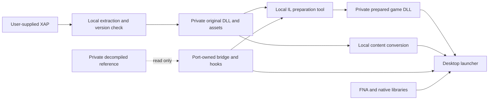

# Recompilation without shipping the game's decompiled code

## Decision

Make this repository the new port project. Treat the original **compiled** `ZombiesWP7.dll` inside a user-supplied XAP as the game implementation. Keep the decompiled tree in `../z0mb1es-on-teh-fna` as a private, read-only reference; it is never a project reference, build input, package input, or submodule of the new project. All port behavior belongs in independently maintained launcher, compatibility, and patch code in this project. A local preparation command produces the runnable, transformed game assembly from the user's XAP. The transformed assembly and extracted assets remain local.

This is an architecture and migration plan, **not yet a working port**. The XAP extractor and assembly metadata inspector described below are implemented and tested here. Loading, rewriting, and playing the original DLL still require the implementation and gates below. No architecture alone establishes rights to distribute the patcher, the game, or derived outputs; get a rights review before release.

## Evidence from this copy

The local `Z0MB1ES (on teh ph0ne) v1.0.0.0.xap` is a ZIP archive with 127 entries and 76,993,533 uncompressed bytes. Its SHA-256 is `6b88c7fbd95444d2560b4b11e6f35d40a6c0f7abc30706155dcbccd18bc333fe`. It contains `ZombiesWP7.dll` (750,136 bytes), 91 `.xnb` files, three `.wma` files, and companion data. `AppManifest.xaml` names `ZombiesWP7.Game1` as the entry type; the phone manifest declares XNA and platform version 7.1.

The DLL's SHA-256 is `7b819cb562826ae4d2592ff741877e76da0e57bfbe48192aabb79319fdb36823`. It identifies itself as `ZombiesWP7 1.0.0.0` with 178 types and 818 methods. It references `mscorlib` and `System` **2.0.5.0**, five XNA 4.0 assemblies (including `Microsoft.Xna.Framework.GamerServices`), `Microsoft.Devices.Sensors` 7.0, and `Microsoft.Phone` 7.0. Its metadata exposes `Game1.Initialize`, `LoadContent`, `Update`, `Draw`, and `OnExiting`, plus `StorageMgr.Read/Write`, `TrialMgr.CheckTrial`, `AchievementMgr.AwardAchievement`, and `Music` methods. The `InputMgr` in the old source tree is a port addition; there is no `InputMgr` type in this original DLL.

Comparison against the old project's local FNA `net8.0` build found the core XNA type names, but 14 referenced GamerServices types are absent (including `GamerServicesComponent`). This is a **type-name check only**; it does not prove member signatures, virtual methods, content handling, or game execution. The old repository also changes `Game1` directly for rendering, input, saves, achievements, trial behavior, media, and assets, so it cannot be used as a distributable source base.

## Boundaries and build flow



Project layout, following the same separation used in the Xenon recomp while keeping .NET/FNA-specific projects:

```text
docs/architecture.md
docs/plans/implementation-prompts.md
config/                           # supported XAP identities, tool/dependency pins
docs/                             # evidence, guides, implementation log, limitations
game/                             # optional local XAP drop folder; contents ignored
assets/                           # future original port artwork only
installer/                        # wizard, helper, build and tests; never game data
patches/                          # authored patch specs and guarded hooks
scripts/                          # build and distributable audits
src/Port.Launcher/                # future desktop entry point
src/Port.Bridge/                  # future authored API shims and port services
src/Port.Prepare/                 # future shared local preparation engine
src/Port.Hooks/                   # future authored replacements/injections
src/Port.Content/                 # future local asset conversion pipeline
tools/prepare-cli/                # future developer CLI using the shared engine
tools/extract_xap.py              # implemented: developer ZIP extraction tool
tools/inspect_assembly/           # implemented: read-only metadata inventory
generated/                        # ignored, reproducible local generated code/data
out/                              # ignored, builds and installer artifacts
private/original-xap/             # ignored, extracted user package
private/prepared/                 # ignored, generated DLL and content
../z0mb1es-on-teh-fna/            # existing private reference only
```

`src/` contains host-owned runtime code, `patches/` records exactly which original methods are changed, `config/` pins supported inputs and dependencies, and `docs/` carries evidence. These are the useful Xenon conventions. The Xbox translation SDK, CMake, generated C++, and STFS handling are specific to that project and do not belong in this FNA port. The XAP, `game/` contents, `generated/`, `out/`, and `private/` are ignored by this directory's `.gitignore`. Do not add original `.cs`, `.dll`, `.xnb`, `.wma`, maps, textures, or generated patched binaries to a release artifact or Git history. Check the release archive itself, including symbols and embedded resources. The old repository's history already contains decompiled code, so make the new release repository from a fresh history; copying that repository and deleting its source in a later commit would retain it in history. Existing forks and remote copies need separate handling.

| Xenon convention | This port |
| --- | --- |
| `game/` ignored local source | Optional local XAP folder; installer also accepts any XAP path |
| `src/hooks/` and `patches/` | Authored .NET hooks plus guarded IL patch records |
| `config/` fingerprints/pins | Supported XAP identities and pinned FNA/content/IL dependencies |
| `generated/`, `out/` | Ignored local generated data and build products |
| `docs/` and bring-up records | Evidence ledger, implementation log, guides, limitations |
| `installer/` wizard and helper | Inno Setup wizard plus .NET preparation/install helper |
| `scripts/setup/audit_distributable` | New release audit for the one-file setup executable |

### Preparation order

1. Require the user's XAP path. Verify its SHA-256 against an explicit supported-version table, then inspect package structure. Fail closed on unknown builds. The hash above identifies this one local sample; do not hard-code a claim that it identifies every legitimate copy.
2. Extract to `private/original-xap/` with `tools/extract_xap.py`. Keep the source DLL byte-for-byte intact and record its hash. Use a new empty output directory per attempt.
3. Prepare assets locally. Adapt the old extractor *workflow* for this project, with its dependencies pinned and licenses recorded; it converts phone XNB/audio and moves companion folders. Do not copy extracted content into tracked source. Preserve `Arial.xnb` handling as a separate validation item, since the old pipeline explicitly excluded it from conversion. The inspected XNB samples use `XNBm` version 5, so test actual load behavior with FNA rather than assuming compatibility.
4. Build the launcher, bridge, and hooks from authored source. Run a deterministic IL rewrite of the **original DLL on the user's machine**. Use a managed IL writer such as [Mono.Cecil](https://www.mono-project.com/docs/tools%2Blibraries/libraries/Mono.Cecil/) for this stage, pinned to a tested version. `System.Reflection.Metadata` in the current inspector is read-only here.
5. Launch the prepared assembly only after all references and required patches pass validation. The launcher creates `ZombiesWP7.Game1` through reflection and calls `Run` within FNA's runtime. Do not distribute a preprepared DLL.

### Player-facing installer

Follow the Xenon project's **product shape**: one Windows setup executable carrying the authored runtime and a preparation helper. Use an [Inno Setup custom wizard page](https://jrsoftware.org/ishelp/topic_scriptpages.htm) for the XAP picker; keep ZIP parsing, hashes, IL rewriting, content conversion, file placement, and manifests in the .NET helper, not Pascal Script. The release setup must work offline and must not require Python, the .NET SDK, or a compiler on the player's machine. `tools/extract_xap.py` remains a developer tool; the helper must implement the same safe extraction contract in the shipped runtime.

**The player selects a XAP they already have.** The setup contains no XAP, original DLL, content, or preprepared game output. The installer design is specified in [installer/README.md](../installer/README.md).

The wizard flow is: welcome and requirements; install folder; XAP selection and read-only validation; ready summary; preparation/install progress; finish with Launch or Close. Validate identity and required entries before any installation changes. Stage the prepared DLL/content, verify them, then commit so a failed import cannot leave an apparently successful install or destroy a prior playable one. Record input/output hashes and versions in a local install manifest and human-readable report. Reinstall/update may reuse verified installed generated game data when compatible; otherwise ask for the XAP again. Do not retain a copy of the XAP by default. Keep saves outside the install directory and preserve them on uninstall unless the player explicitly chooses removal.

### Why the rewrite must precede hooks

The CLR resolves type and assembly references while loading types and JIT-compiling methods. A runtime hook cannot repair a missing base type such as `GamerServicesComponent` after loading fails. The preparer must first retarget XNA core type references to the one `FNA` assembly; route GamerServices and phone-only types to `Port.Bridge`; and rewrite unsupported .NET/Windows Phone calls. It must update *type scopes, member references, signatures, generic arguments, custom attributes, and exception handlers* as applicable, not just rename AssemblyRef rows. Validate every changed method body and every referenced member before running. Avoid pretending an assembly-resolution callback alone can make old XNA types appear in FNA.

Prefer narrow authored compatibility types for services that the original DLL expects (`GamerServicesComponent`, sign-in/profile, achievement and leaderboard APIs, sensors, vibration, phone tasks). Implement only the signatures actually used by the pinned DLL. The bridge owns the desktop behavior: local profile, save path, offline achievements, trial policy, and media access. Core FNA types come from FNA, not shadow copies of XNA's assemblies. Inspect FNA's APIs against *members*, not just names, and patch or adapt mismatches explicitly. The `mscorlib`/`System` 2.0.5.0 references and isolated storage calls are a separate binding/compatibility gate, not an assumed automatic fix.

### Patch contract

Keep each adaptation in `Port.Hooks` or `Port.Bridge`; the preparer only wires calls to it. A patch record should identify the original XAP hash, target assembly/type/method with full signature, expected method-body hash or structural IL pattern, transformation, bridge method, and postcondition. Refuse to patch if an anchor or expected body differs. Write the prepared DLL to a new path, never over the original. Ensure repeat runs produce the same output hash for the same inputs and tool versions.

Use the smallest safe interception point. For example, a prefix or replacement of `StorageMgr.Read/Write` can delegate to an authored desktop save service; `Game1.Draw` can be wrapped by an authored presenter; `Game1.Update` can call an authored input adapter before the original logic. These are candidate hooks, not verified requirements. For features that require changing many instructions, replace only the identified method body with a call to authored logic **after** mapping its required original behavior. Preserve original object fields, static initialization, game timing, and `base` calls where required. Hook methods can accept `object` and stable primitives or use a generated, local-only interface facade; the distributable source must not compile against decompiled game source. Reflection is acceptable at narrow boundaries but should not be the entire hot path.

Runtime patching (for example, [Harmony](https://harmony.pardeike.net/v2/)) can supplement optional behavior **after** the prepared assembly loads, but is not the primary compatibility layer. Start with deterministic, testable pre-load IL rewriting. A compiler from a decompiled project would reintroduce the source distribution problem.

## Migration of work from the old repository

| Existing work seen in `../z0mb1es-on-teh-fna` | New owned boundary | First verification |
| --- | --- | --- |
| Desktop `Program` and modified `Game1` lifecycle | `Port.Launcher` plus narrow `Game1` hooks | Construct, load, update, draw, exit |
| Mouse/controller additions in new `InputMgr` | `Port.Bridge/Input` and update hook | Touch, mouse, pad, pause, menu in both modes |
| Render target, integer scaling, asset scaler | `Port.Bridge/Presentation` and content adapter | Determine original viewport first; then verify resizing, fullscreen, texture dimensions |
| Phone storage changed to `FileStream` | `Port.Bridge/Storage` and storage method hooks | Read/write fresh and existing saves; version handling |
| GamerServices, trial, achievements, leaderboards | `Port.Bridge/Services` plus selected hooks | Offline behavior, progress persistence, no stalled dialogs |
| Media library and converted WMA/audio | `Port.Bridge/Media` plus local content pipeline | All songs/SFX play and stop at correct times |
| Sensors, vibration, marketplace tasks | `Port.Bridge/Phone` compatibility methods | No startup or gameplay load failures |
| Optional PNG swapping and upscaling | Later bridge/content feature | Base game works first; overrides load only when selected |

Use the old commits and source only as a requirements checklist. Their output is a diagnostic reference, not a behavioral oracle: it may contain accidental gameplay changes. Reimplement authored behaviors in new files, and review each candidate copied helper for original game code or data before moving it. Some work will be reusable as an idea or independently written algorithm; the decompiled game methods themselves stay private.

## Proof gates before calling this architecture working

1. **Metadata/ABI gate:** Produce a machine-readable report of all external type and member references and prove each resolves to FNA, the bridge, or the target runtime. Include inheritance, overrides, events, delegates, serialization, and reflection-observed names. The current inspector provides the first type inventory only.
2. **Boot gate:** Rewrite the exact sample DLL, launch without the phone assemblies, reach the menu, and exit cleanly with no `FileNotFoundException`, `TypeLoadException`, `MissingMethodException`, `InvalidProgramException`, or native library failure.
3. **Content gate:** Convert/copy all user-owned content locally and load every needed asset, including font, songs, texture sheets, and companion data. Compare behavior with an original-runtime observation when available and the original DLL's logic; use differences from the old port as leads to investigate, not automatic failures.
4. **Behavior gate:** Test every mode and feature confirmed in the original XAP, including endless/perks where present, plus input, save/load, achievements, pause/resume, quit/restart, and different resolutions. Recheck the exact methods and effects of each patch.
5. **Release gate:** Build the one-file installer containing only launcher, bridge, hooks, preparation helper, pinned permitted dependencies, and instructions. Scan tracked files and the setup executable for the original assembly, decompiled source, game assets, and generated outputs. Test a clean Windows machine with an independently supplied XAP and no developer tools. Obtain a rights review before any public distribution.

## Tools available now

From the repository root on Windows with Python 3.12 and .NET 8+:

```powershell
python tools/extract_xap.py '.\Z0MB1ES (on teh ph0ne) v1.0.0.0.xap' --list
python tools/extract_xap.py '.\Z0MB1ES (on teh ph0ne) v1.0.0.0.xap' --output private/original-xap
dotnet run --project tools/inspect_assembly -- private/original-xap/ZombiesWP7.dll
dotnet run --project tools/inspect_assembly -- private/original-xap/ZombiesWP7.dll 'D:\Gabriel\Documentos\Coding\decomps\fna\z0mb1es-on-teh-fna\src\FNA\bin\Debug\net8.0\FNA.dll'
```

The extractor validates archive paths, rejects links and duplicate names, refuses to write into a nonempty destination, and prints a package hash and size summary. The inspector uses only .NET's metadata reader; it does not execute or decompile the game. The extraction command above has already succeeded for this XAP and produced the ignored `private/original-xap/` tree. Re-extraction requires a new empty destination or removing the old local copy deliberately.

FNA's [documentation](https://fna-xna.github.io/docs/) describes it as an XNA 4.0 reimplementation; its [XNA porting guide](https://fna-xna.github.io/docs/2a%3A-Building-XNA-Games-with-FNA/) discusses content and native libraries. These references support the chosen base library, while the phone-specific ABI and this game's runtime behavior still need the proof gates above.
